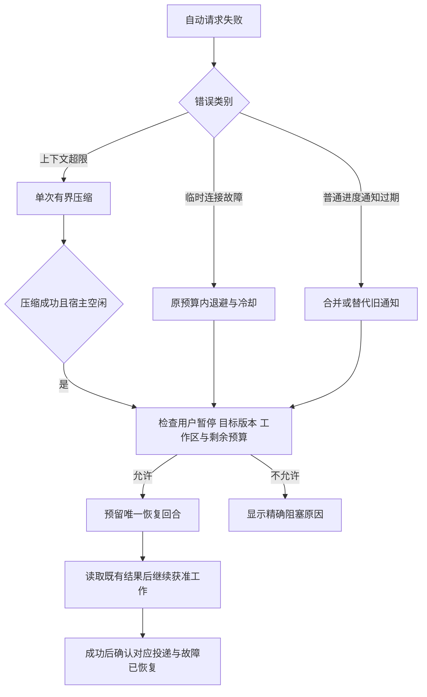

# 自动唤醒失败与长周期任务恢复调研

日期：2026-10-18，Asia/Shanghai。代码基线：2.0.15，`86a9a46`。本轮接续原对话最后的截图问题，完成现场只读取证、固定版本参考源码对照和隔离故障复现。

## 结论

需要优化，而且现场已经证明这会阻塞原本获准的长周期任务。当前实现把投递故障、没有进展、预算耗尽统一归入 `attention`，又把解除这些状态的常规入口绑定到用户手动执行 `/mission resume`。压缩成功、主模型恢复正常后，旧投递的失败计数仍在，工作不会自行恢复。

截图对应的任务没有被用户暂停。真正堵住它的是一条小时进度通知；主模型随后用 `mission_decision` 将这个运行故障登记成了“需要用户裁决”。这既有运行核心的状态建模问题，也有工具引导和模型使用问题。

建议由运行核心在原授权、原目标和剩余预算内恢复可恢复故障；用户暂停、预算续期、工作区或分支授权及真正的业务裁决各有独立入口。单纯增加重试次数、允许模型调用通用 resume，或要求重新开会话，都不能解决这条故障链。

## 现场证据

原会话：`01a14894-40b9-73bd-ab3f-d474ad8052ed`；目标：`e19924ea-1e4a-4659-8131-b0c871b3084e`。

本轮在北京时间 **11:03:00** 读取 SQLite 的一致性只读快照，并流式解析原 JSONL。未创建原状态库的 Store 实例，未取得其 owner lock。

| 现场字段 | 记录 |
| --- | --- |
| `status` | `attention` |
| `humanPaused` | `false` |
| 原因 | `Automatic wake attempts failed...resume explicitly.` |
| 自动回合 / 主模型输出 token | 22 / 34794 |
| `emptyTurns` | 0；现场不是“连续没有进展”触发 |
| 未处理投递 | 2 条，均为 `maintenance:progress` |
| 旧投递 | `73f9e668-a840-47f1-8b2a-f75146a3b927`，`pending`，`attempts=3` |
| 新投递 | `8db2027d-ab36-4ae9-a655-80af7a97069b`，`pending`，`attempts=0` |
| 用户控制事件 | 已保存事件中没有 `user.pause`、`user.stop` 或 `user.resume`；有 `decision.human-input` |

证据脚本及完整本地派生结果位于被 Git 忽略的 `.reference/investigation/2026-10-18/wake-recovery-evidence.mjs`、`wake-recovery-evidence.json`。原始 JSONL 中的公开消息、工具结果和 custom message 分别解析，未读取或转存思考正文。派生结果含会话公开内容，留在本地，不纳入提交。

### 实际时间线

下表均为 **2026-10-18 北京时间**。L 表示本轮按 LF 计数的原日志行号。

| 时间 | 证据 | 发生的事情 |
| --- | --- | --- |
| 02:41:42 | SQLite 旧投递；L585 | 创建小时进度通知并发起第一个 wake batch |
| 02:41:58–02:49:12 | L590–655 | 同一投递共 3 个 wake batch；每批 1 次初始失败及 10 次 `mission-reconnect`，合计 33 条上下文超限错误 |
| 08:31:13 | L660 `goal_status` | 已显示 `attention`、`humanPaused=false`，原因是自动唤醒失败 |
| 08:33:15–08:35:38 | L680–701 | 另一次用户回合又记录 11 条上下文超限错误；历史合计 44 条 |
| 10:11:37 | L702 `compaction` | 原会话已正式保存成功压缩检查点；`tokensBefore=562234` |
| 10:12:00 | L704 | 用户明确说“继续工作，确认是压缩插件的问题，已经修了” |
| 10:14:01 | L728–729 | 两次 `team_send` 被 `Mission attention` 拒绝，没有新任务身份 |
| 10:14:10 | L730–731 | `supervisor_control(action=resume)` 被拒绝，只允许用户通过 `/mission` 控制 |
| 10:22:15 | L780–781 | 主模型调用 `mission_decision`，理由是需要用户手动恢复；目标变成 `waiting_user` |
| 10:41:08 | L797–798 | 小时提醒仍能唤醒等待裁决的主会话，但主会话只重复报告等待用户恢复 |
| 10:54:12 | L800；事件序号 48 | 用户问“你自己不能执行吗”；`onHumanInput` 解除 `waiting_user`，随后维护循环又因旧投递 `attempts=3` 写回 `attention` |

第三个 wake batch 在 L634；每批 reconnect 的 retry 计数都重新从 1 到 10，证实了两层重试的放大。这里的 33 次是确定的历史事实，不能据此声称 2.0.15 仍会把同一上下文错误重连 33 次：2.0.14 已修复该错误的识别，见 [压缩失败排查](COMPACTION-FAILURE-2026-10-18.md)。本轮确认的是修复之后留下的恢复状态和计数没有得到处理。

最后一次 `active → attention` 没有单独的状态变更事件；事件时间、当前快照和代码路径共同支持这一还原，隔离实验也复现了同样结果。当前事件表不足以还原每次历史状态切换的准确毫秒，需要补充运行事件。

## 代码中已经确认的问题

### 1. 一条耗尽重试的进度通知可以阻塞整个任务

[`runtime/kernel.ts`](../../../runtime/kernel.ts) 的 1188–1204 行检查所有归属当前目标的 pending delivery，只要有一条 `attempts >= maxWakeAttempts` 就令整个 Mission 进入 `attention`，没有区分结果、失败、决策和可替代的小时进度通知。

`pump()` 的 1215–1219 行对 `attention` 整体拒绝自动投递；`dispatch()` 的 476–479 行拒绝非 active 目标的新任务。因此旧进度通知同时阻塞新的成员任务和新的提醒，影响范围超过了那一条通知。

对照起来，`waiting_user` 状态下仍允许 result/failure/recovery/reminder 等通知进入主回合。于是会出现截图中的现象：定时提醒继续花费模型调用，但恢复派工失败，主会话重复请求同一人工动作。

### 2. 没有“故障已修复”的状态转换

`onHumanInput()`（152–166 行）只自动处理非用户暂停的 `waiting_user`，不会处理 `attention`。成功的普通主回合同样不会清除该状态。重启会释放 leased/admitted 投递，但保留其 attempts，不能消除这个旧故障。

[`extensions/mission-control/index.ts`](../../../extensions/mission-control/index.ts) 尚未订阅 `session_compact` 或 `session_compact_failed`；它把 assistant 结果压缩为一个 error 布尔值交给核心，没有把错误类别、压缩完成及恢复阶段关联起来。

Pi 1.3.0 已有公开压缩事件和 `ctx.compact()`。但 `session_compact` 发出时手动压缩尚未清掉 busy 状态，见 [`agent-session.ts`](../../../vendor/pi-1.3.0/packages/coding-agent/src/core/agent-session.ts) 2887–2910 行。正确做法是登记恢复条件，在宿主真正 idle 且无竞争输入后申请一次回合，不能在事件回调里立即强发请求。

### 3. 运行故障可被登记成伪用户裁决

`supervisor_control`（index.ts 902–917 行）的通用拒绝消息将 resume、pause、stop 都归为用户控制，没有提供“运行故障由谁恢复”的替代路径。模型看到这个错误后，使用了 `mission_decision`。

`requireDecision()`（kernel.ts 842–853 行）只接受一段 reason 就能覆盖状态，没有结构化的问题、决策身份和阻塞范围，也没有检查请求是否其实在报告运行故障。真实需要选择资源、范围或验收口径的问题，应与“投递失败，请运行命令”区分开。

仅加提示词不足以保证区分。运行核心需要保存机器可识别的故障原因，并为工具返回结构化类别和可执行的下一步。`mission_decision` 应提交具体问题及受阻工作；被旧版本登记的泛化 reason 不能通过字符串猜测全部自动清除。

### 4. “没有进展”的统计对象不正确

`leadSettled()`（898–948 行）对有 wake reservation、没有被标记 acted、没有活动任务的回合累加 `emptyTurns`，没有要求主请求成功，也没有区分 wake 的业务用途。

所以连续三个失败请求，以及连续三次正常处理而没有新工作的提醒，都可能进入“没有进展，需要手动恢复”。反过来，index.ts 336–350 行把多数工具的调用本身算作 acted，包括普通文件读取，且发生在工具成功之前。因此“没有进展”与“是否调用了某个工具”并不等价。

现场 `emptyTurns=0`，这个问题是隔离实验发现的相邻缺陷，不是本次锁死的直接原因。

### 5. 预算更新与恢复动作耦合，另有绕过用户暂停的入口

`userControl('resume')`（781–840 行）一起重置投递 attempts、时间预算、回合和输出计数。正常故障恢复如果复用它，就会不断获得新预算。

`updateGoal()`（244–270 行）更直接：编辑目标会设置 active、清除 `humanPaused` 和 relocation hold，并重置预算。通过当前 `goal_update` 工具可以到达，隔离实验已确认它能清掉真正的用户暂停。这与“只有用户可恢复暂停”的其他入口不一致；本轮未用这个入口恢复真实任务。

修改目标文本、恢复运行故障、解除用户暂停和增加预算必须各有明确语义，不能依靠换一个工具名称间接达到同一效果。

## 固定版本参考实现

本轮以实际保存的源码为依据，不把上游策略直接视为本插件必须采用的产品规则。

| 参考 | 已核对机制 | 可借鉴之处与限制 |
| --- | --- | --- |
| Pi 1.3.0 | [`agent-session.ts`](../../../vendor/pi-1.3.0/packages/coding-agent/src/core/agent-session.ts) 的 `_isRetryableError`、压缩及 settlement；[`types.ts`](../../../vendor/pi-1.3.0/packages/coding-agent/src/core/extensions/types.ts) 的公开事件 | 上下文超限走压缩，不是普通重连；在真正 idle 后续跑，避免与原生恢复并行 |
| pi-goal-x 0.32.3 | [`goal-events.ts`](../../../.reference/published/pi-goal-x-0.32.3/package/extensions/goal-events.ts) 308–338、548–578 行；[`goal-runtime.ts`](../../../.reference/published/pi-goal-x-0.32.3/package/extensions/goal-runtime.ts) 117–143 行 | 压缩、原生恢复、目标续跑分层；恢复失败不直接伪装为用户暂停；`agent_settled` 后再安排恢复 |
| pi-goal-x 0.32.3 | [`goal-scheduler.ts`](../../../.reference/published/pi-goal-x-0.32.3/package/extensions/goal-scheduler.ts) 的 owner/generation/dispatch claim | 恢复回合同样需要精确身份与去重；重启不盲目重放旧 claimed 执行 |
| DeepSeek Harness `1517a4d` | [`GoalActivation`](../../../.reference/sources/deepseek-harness/packages/goal/goal/src/types.ts)、[`resume`](../../../.reference/sources/deepseek-harness/packages/goal/goal/src/index.ts) 364–382 行、[`tool authority`](../../../.reference/sources/deepseek-harness/packages/goal/tool-goal/src/authority.ts) | 目标生命周期与当前进程续跑资格分开；resume 不清历史轮次；权限来自宿主事件和精确目标版本 |

pi-goal-x 的网络恢复策略有一个不能忽略的差异：[`network-error-backoff.ts`](../../../.reference/published/pi-goal-x-0.32.3/package/extensions/network-error-backoff.ts) 默认 `maxAttempts=0`，表示无限重试；计数在内存中。可以借鉴其分层与退避，不能照搬为本插件的默认预算策略。

DeepSeek Harness 的 [`tool-goal`](../../../.reference/sources/deepseek-harness/packages/goal/tool-goal/src/index.ts) 270–290 行仍明确拒绝由模型恢复 paused 目标。这支持“保留真正的用户暂停边界”，不支持“所有 attention 都要求用户敲命令”。

## 建议的恢复模型

### 分开保存原因和权限

保留目标生命周期，另外增加有类型的 hold/recovery 信息。字段名称可在实施时调整，至少表达：原因类别、来源、目标 id/revision、故障 id、关联投递、首次及最近失败时间、重试用量、下一检查时间和恢复依据。

| 情况 | 建议行为 | 恢复是否重置目标预算 |
| --- | --- | --- |
| 用户 pause/stop、分支切换或迁移保护 | 保持停止；只接受对应宿主控制或已有精确授权 | 由显式预算操作决定 |
| 预算耗尽 | 显示哪一种预算耗尽，等待明确续期 | 明确续期才修改 |
| 真实业务决策 | 保存 decisionId、具体问题和受阻范围；未受阻工作按既有授权继续 | 否 |
| 临时 provider/投递故障 | 在既有预算内退避；到上限后冷却，只有允许的条件变化才重新探测 | 否 |
| 上下文超限 | 停止重发同一上下文；等待或发起一次有界压缩；成功后安排一次恢复回合 | 否 |
| 过期的普通进度通知 | 合并或标为 superseded，保留审计；不因它暂停整个目标 | 否 |
| 结果/失败通知仍不能消费 | 保存完整产物及明确未消费状态，隔离该投递并诊断；不得假装 observed | 否 |
| 成员执行被中断 | 先核对产物及进程；确需重试时创建新 attempt，不重放旧命令 | 否 |

“冷却后探测”仍需有界：持久保存恢复次数或恢复时间窗口，并计入原请求、扩展重连和 outbox 重投的总体请求额度。不能让每条投递、每次新 wake 或每次重载都重新获得一整轮网络重试。首次失败可短退避，连续失败采用较长冷却；具体秒数应通过故障注入确定，不能拿增加重试次数代替分类。

### 现场应走的路径



压缩成功只表示上下文修复完成；故障恢复回合成功、对应消息实际进入请求后，才能确认消费。不能把压缩事件本身当成所有旧结果已处理的证明。

运行核心自动恢复应为主路径。若提供模型工具，例如 `mission_recover(faultId, expectedRevision)`，它只能请求检查并重试当前可恢复故障，不能清除 user hold、分支或工作区 hold、真实 decision，也不能续预算。工具调用本身不构成“故障已修复”的证据。

普通交互消息也不应全部当成业务决策已解决。“进度如何”与选择了某个目标不是同一个事件。宿主记录消息来源，模型可以说明答复对应哪个 decision；核心校验身份和当前版本。旧式 reason-only 的裁决需要可审计的迁移，无法确认类别的保留为 unknown。

### 限制误判和重复提醒

没有进展的防护只统计成功的、明确要求推进工作且没有实际推进的 continue/recovery 回合。失败请求、例行报告、只需确认的提醒和有明确截止时间的外部等待不计入。判定应使用任务接纳、有效状态变化、证据或验收进度，而非“调用了任意工具”。

普通进度通知按当前目标和报告周期合并，只保留需要处理的最新摘要。状态没有变化且没有可执行动作时，不反复启动模型来重复报告同一阻塞；本地维护仍可继续检查，并在故障恢复、完成、失败或需要新决策时通知。

## 建议实施顺序与验收

第一步针对现场：给 `attention` 增加类型和来源；接通压缩成功/失败到恢复状态的路径；隔离耗尽重试的旧 progress；普通故障恢复保留原预算。同步阻止 `goal_update` 清除已有用户暂停、迁移保护和预算限制。旧版数据只有满足已知故障分类及全部恢复条件时才能迁移，不能将所有 attention 批量设 active。

第二步完善长期运行：统一恢复请求额度、持久冷却和唯一恢复 reservation；结构化业务决策与声明式外部等待；缩小 no-progress 的统计范围；为提醒合并、状态变化与故障恢复保存事件。沿用已有 generation、lease、outbox 和产物机制，无需把命令重放加入恢复流程。

实施后的关键验收应包括：

1. 先制造与现场相同的 3 次失败 progress，随后成功压缩；在没有新用户控制命令时，只启动一个恢复回合，读取旧结果并接受下一项已获准任务，原预算计数保留。
2. 压缩事件触发时仍 busy、原生恢复尚在执行、用户输入已排队时均不抢开回合；失败或取消的压缩不误标健康。
3. 用户 pause、Escape hold、stop、分支切换、工作区迁移与预算耗尽均不被自动恢复或 goal_update 清除；陈旧 faultId/revision/generation 无效。
4. 连续网络故障的全部请求数受同一预算限制；重启保留恢复用量，不通过新 wake 获得新额度。
5. 一个过期 progress 不阻塞新任务或独立提醒；未消费的结果保留原身份和产物，不假报 observed，不重复执行已完成命令。
6. 三次失败请求、三次正常提醒和明确外部等待不会触发“没有进展”；真正无推进的成功自动继续仍能被识别。
7. 用户问进度不解答业务裁决；用户对具体 decision 的答复只解除对应阻塞。
8. 记录 `recovery.opened/deferred/probe/succeeded/exhausted`、投递 superseded/quarantined 及状态变更的旧值、新值、原因；不把完整对话重复写进状态事件。

## 本轮验证与边界

隔离脚本 `.reference/investigation/2026-10-18/wake-recovery-repro.mjs` 直接调用当前生产 MissionKernel，使用临时 SQLite、假时钟和禁止启动 worker 的工厂。运行命令：

```text
node --experimental-strip-types .reference/investigation/2026-10-18/wake-recovery-repro.mjs
```

7 个断言场景全部通过，确认的是当前缺陷可复现：

1. 耗尽重试的 progress 导致整体 attention，并拒绝新派工。
2. 用户输入及成功普通主回合不会清除 attention。
3. waiting_user 遇用户输入短暂 active，下一 tick 被旧 progress 重新锁住。
4. attention 同时拦住新建的独立提醒。
5. 三次失败请求被算成三次没有进展。
6. 三次成功、全部 observed 的例行提醒同样触发没有进展。
7. goal_update 能清除显式用户暂停并重启预算。

上述调研阶段仅新增文档与本地复现材料，未修改生产运行逻辑。原复现脚本记录的是2.0.15缺陷断言，更新后应改用正式修复回归，不再以旧缺陷仍可复现为通过条件。

联网检索本轮未返回可引用正文。上游对照限定为已下载的固定版本源码；源码版本和来源由 `.reference/catalog/upstream-sources.json`、`.reference/catalog/npm-metadata/` 记录，不能据此声称覆盖上游最新实现。

## 2.0.16实施结果

用户随后授权实施。恢复状态已独立保存于SQLite的`leadRecovery`元数据，包含故障id、目标版本、context/provider/delivery类别、恢复阶段、共享请求用量、探测用量、冷却和压缩依据。默认11次自动恢复请求，并在该额度内限制冷却后的额外探测次数；原生重试、扩展重连和outbox重投共同计数，重载保留用量。

上下文超限不重发旧请求，宿主idle后发起一次有界压缩；只接受当前会话实际保存的压缩检查点，下一次idle再领取唯一恢复batch。错误或取消保留历史、缓存和原因，不自动循环压缩。提供方自行返回aborted归入运行故障；用户Escape及运行核心因额度拒绝请求有不同处理，后者不会制造用户暂停。自定义提供方须遵守Pi的AbortSignal；不能把不合作的网络客户端视为已获得OS级强制隔离。

已知旧wake失败attention按明确原因迁移，原预算保留；旧progress标为superseded，未消费关键通知保留并可隔离或显式收集。未知attention和旧reason-only waiting_user不会按自然语言猜测自动解锁。普通成功回复只证明连接恢复，不能把未进入请求的旧结果标为observed。

`goal_update`不解除暂停或续期预算；故障、决策和外部等待身份随目标revision更新，旧请求无效。业务裁决支持taskIds范围，新交互用户答复后用精确decisionId显式resolve；外部等待保存id/token/截止时间，并在信号或到期时通知一次。只有成功continue且没有实际推进的回合计入no_progress，失败请求和例行提醒不计入。

正式回归位于`tests/v2/recovery.test.mjs`及`tests/v2/pi-integration.test.mjs`：21项新增核心用例、5项新增真实Pi生命周期用例，覆盖现场迁移后真实派工、自动压缩后单次恢复、原生重试共享额度、交互答复身份和提供方中断。原有Kernel回归同步更新为新语义，全部测试使用隔离Pi目录和离线provider。

实施过程中没有为原硬件任务写状态、解除暂停或执行硬件工作，没有调用真实模型。整夜负载、真实网关长时间断网和各硬件工具链仍需后续运行验收。加载2.0.16时先等成员收束，再`/reload`或恢复原会话；真实用户暂停和已耗尽的原目标预算仍需显式`/mission resume`。
