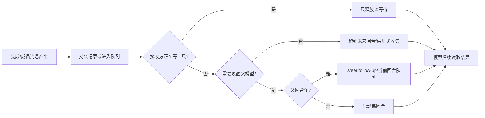

# 子智能体、持久团队与完成唤醒：源码机制调查

核对日期：2026-10-17（Asia/Shanghai）。本文记录源码实际调用链，供后续设计和故障复盘引用；不构成实现方案或运行兼容性验收。未运行上游/插件测试、未调用模型，也未改动业务代码。

## 版本与证据边界

| 对象 | 本次核对版本/身份 | 说明 |
|---|---|---|
| Codex | `e16b631d08cdf82773831f9bbfb793da687d5299` | 公开仓库的本地浅克隆；不等同于 Codex 桌面应用的全部实现。 |
| DeepSeek Harness | `1517a4dbca0a2789ff1d41ba439600f8547d23fa`，`dsh-v0.2.1-alpha.5` | agent-team 位于 experimental；不能把参考实现视为已稳定发行的成品。 |
| Pi 本机运行基准 | `vendor/pi-1.3.0`，`@earendil-works/pi-coding-agent` 1.3.0 | 本报告以此为现插件宿主时序的主要基准。 |
| Pi 上游检出 | `8efd314fa3d3232ce197d8d7a6a5660530b9d83e` | 新于 1.3.0 的当前检出；未用它替代安装运行基准。 |
| pi-subagents Git HEAD | `f8ada81303db6ee76ed22fee5605dc8a8d62a83a`，包版本 0.78.0 | 工作树干净。 |
| pi-subagents 发布包 | `pi-subagents@0.78.0` | npm tarball SHA-512 与元数据已由 `.reference/catalog/published-artifacts.json` 记录并核验。发布包是编译后的 JS，HEAD 是 TS；本次对 `parent-wake` 和 completion replay 关键逻辑逐段比对，行为一致，文件表示和行号不同。 |
| 本插件 | Git HEAD `c34e32fec02d43808c2e4d8b313017dba2347993` | 当前工作树已有 `.gitignore` 未提交修改；本调查没有修改它。 |

下文的路径简写均按此表映射到**固定的仓库根目录相对路径**；行号按该文件从 1 起的源码行号。对同一文件在段内再次引用时，保留该绝对路径首引并给出精确行号。

| 组件 | 源码路径（相对仓库根目录） |
|---|---|
| Codex spawn | `<repo>/.reference/sources/codex/codex-rs/core/src/tools/handlers/multi_agents_v2/spawn.rs` |
| Codex message/wait/interrupt tools | `<repo>/.reference/sources/codex/codex-rs/core/src/tools/handlers/multi_agents_v2/message_tool.rs`；`<repo>/.reference/sources/codex/codex-rs/core/src/tools/handlers/multi_agents_v2/send_message.rs`；`<repo>/.reference/sources/codex/codex-rs/core/src/tools/handlers/multi_agents_v2/wait.rs`；`<repo>/.reference/sources/codex/codex-rs/core/src/tools/handlers/multi_agents_v2/interrupt_agent.rs` |
| Codex agent control/spawn/completion | `<repo>/.reference/sources/codex/codex-rs/core/src/agent/control.rs`；`<repo>/.reference/sources/codex/codex-rs/core/src/agent/control/spawn.rs`；`<repo>/.reference/sources/codex/codex-rs/core/src/agent/control/completion.rs`；`<repo>/.reference/sources/codex/codex-rs/core/src/agent/control/api.rs` |
| Codex mailbox, residency, delivery, stop | `<repo>/.reference/sources/codex/codex-rs/core/src/agent/control/mailbox.rs`；`<repo>/.reference/sources/codex/codex-rs/core/src/agent/control/residency.rs`；`<repo>/.reference/sources/codex/codex-rs/core/src/agent/control/delivery.rs`；`<repo>/.reference/sources/codex/codex-rs/core/src/agent/control/interrupt.rs`；`<repo>/.reference/sources/codex/codex-rs/core/src/agent/control/legacy.rs` |
| Codex session queue/handler | `<repo>/.reference/sources/codex/codex-rs/core/src/session/input_queue.rs`；`<repo>/.reference/sources/codex/codex-rs/core/src/session/handlers.rs` |
| DSH continuable subagent | `<repo>/.reference/sources/deepseek-harness/packages/subagent/subagent/src/manager.ts`；`<repo>/.reference/sources/deepseek-harness/packages/subagent/subagent/src/lifecycle.ts`；`<repo>/.reference/sources/deepseek-harness/packages/subagent/subagent/src/continuation-messages.ts` |
| DSH Agent driver | `<repo>/.reference/sources/deepseek-harness/packages/core/agent-loop/src/agent.ts` |
| DSH experimental Team | `<repo>/.reference/sources/deepseek-harness/packages/experimental/agent-team/src/index.ts`；`<repo>/.reference/sources/deepseek-harness/packages/experimental/agent-team/src/roster.ts`；`<repo>/.reference/sources/deepseek-harness/packages/experimental/agent-team/src/journal.ts`；`<repo>/.reference/sources/deepseek-harness/packages/experimental/agent-team/src/session-message.ts`；`<repo>/.reference/sources/deepseek-harness/packages/experimental/agent-team/src/activity.ts`；`<repo>/.reference/sources/deepseek-harness/packages/experimental/agent-team/src/task-board.ts`；`<repo>/.reference/sources/deepseek-harness/packages/experimental/agent-team/src/types.ts` |
| Pi 1.3.0 core | `<repo>/vendor/pi-1.3.0/packages/coding-agent/src/core/agent-session.ts`；`<repo>/vendor/pi-1.3.0/packages/coding-agent/src/core/extensions/types.ts`；`<repo>/vendor/pi-1.3.0/packages/coding-agent/src/core/extensions/runner.ts`；`<repo>/vendor/pi-1.3.0/packages/agent/src/types.ts`；`<repo>/vendor/pi-1.3.0/packages/agent/src/agent-loop.ts` |
| pi-subagents HEAD | `<repo>/.reference/sources/plugins/pi-subagents/src/extension/index.ts`；`<repo>/.reference/sources/plugins/pi-subagents/src/shared/parent-wake.ts`；`<repo>/.reference/sources/plugins/pi-subagents/src/runs/background/notify.ts`；`<repo>/.reference/sources/plugins/pi-subagents/src/runs/background/result-watcher.ts`；`<repo>/.reference/sources/plugins/pi-subagents/src/runs/background/wait-completions.ts`；`<repo>/.reference/sources/plugins/pi-subagents/src/runs/background/completion-replay.ts`；`<repo>/.reference/sources/plugins/pi-subagents/src/runs/background/subagent-wait.ts`；`<repo>/.reference/sources/plugins/pi-subagents/src/runs/background/wait-subscriptions.ts` |
| pi-subagents 0.78.0 发布构建 | `<repo>/.reference/published/pi-subagents-0.78.0/package/src/shared/parent-wake.js`；`<repo>/.reference/published/pi-subagents-0.78.0/package/src/runs/background/completion-replay.js` |
| 本插件 Team / Goal / Supervisor | `<repo>/extensions/team/index.ts`；`<repo>/extensions/team/job-graph.ts`；`<repo>/extensions/team/tasks.ts`；`<repo>/extensions/goal/index.ts`；`<repo>/extensions/supervisor/index.ts` |

涉及路径均以 `C:\Users\lishuo\Documents\pi-mission-control` 为根。本文只引用源码和脱敏派生记录；不读取 1GB 原始日志，也不引用内部推理、签名或私有提示正文。

## 先区分五种不同的“送达”效果

下表中的阶段不可互相替代。`落盘/接受`不代表消息已经进入 provider 请求；`唤醒 wait`不代表开始新回合；`开始新回合`也不代表模型已成功处理；API 接受或本地 ACK 不等于模型已读、理解或完成操作。

| 阶段 | 可观察含义 | 常见证据 | 不能据此断言 |
|---|---|---|---|
| 持久记录/会话追加 | 消息或状态进入 session/journal/结果文件 | Pi `appendCustomMessageEntry`/session 消息；DSH session append+flush；Codex rollout/mailbox | provider 已看见；消息已经在活动 turn 中采样 |
| 入队/被接受 | runtime 接受一个输入或队列项，并可能给 submission/message ID | Codex submission ID、DSH inbox messageId、Pi API 已排队 | 会启动回合；会话外重启后仍可重放 |
| 唤醒一个等待中的工具 | 工具等待的 promise/watch 被活动信号释放 | Codex `wait_agent` 的 mailbox activity；DSH TeamActivity waiter；pi-subagents `bg_wait` 的事件/轮询 wake | 父模型新回合开始 |
| 启动新回合/续接当前回合 | runtime 调度模型处理输入 | Pi `sendCustomMessage(... triggerTurn:true)` idle 路径、DSH Agent `followup/steer`、Codex communication 的 `trigger_turn:true` | 请求成功、模型看见完整历史或完成任务 |
| 消费/处理确认 | 模型请求已包含消息，或明确应用层消费状态 | 本次源码中的通用 mailbox/API ACK 不提供强一致的此类确认 | 不能拿 session `message_end`、API 成功或工具已返回替代 |



## Codex：LocalAgentControl、线程树、Mailbox 与 `wait_agent`

### 建立子智能体及身份

Codex 的线程树由每个 session 的 `LocalAgentControl` 和共享 `LocalAgentRuntime` 管理。`LocalAgentControl` 保存 root `session_id`，树运行时负责 agent registry、start admission、spawn 预算、线程 residency 与 mailbox。`spawn_agent` 经 multi-agent v2 handler 进入 `spawn_agent_internal`；它在 child session 创建后写 spawn edge，接收初始输入，再登记状态与创建通知。源头身份是 `SessionSource::SubAgent(SubAgentSource::ThreadSpawn { parent_thread_id, ... })`；runtime 另维护 `AgentPath`，子 thread ID 是长期 session 身份，turn/sub-ID 是一次 turn 身份。

主要路径：

- `<repo>/.reference/sources/codex/codex-rs/core/src/tools/handlers/multi_agents_v2/spawn.rs` L94–183：工具参数解析、target/source 配置和 spawn 调度。
- `<repo>/.reference/sources/codex/codex-rs/core/src/agent/control/spawn.rs` L684–750：获取 parent、判定 MultiAgentVersion、容量、v2 residency slot 和 spawn reservation。
- `<repo>/.reference/sources/codex/codex-rs/core/src/agent/control/spawn.rs` L858–976：持久 spawn edge、initial input admission、reservation commit、agent/thread created。
- `<repo>/.reference/sources/codex/codex-rs/core/src/agent/control.rs` L92–130：`LocalAgentControl` 与 `LocalAgentRuntime` 的 session/tree 绑定。

V2 residency 可以把终态或空闲 child 从 `ThreadManagerState.threads` 卸载，同时保留注册信息；`residency.rs` L38–100 在移除内存 thread 前，将队列 mail 转存到同一 runtime 的 mailbox。此 mailbox 是**进程内 runtime 数据结构**，不是独立磁盘 inbox；来源代码不能证明进程重启后 runtime 内尚未消费的 queue-only mail 一定还在。线程 rollout 与 spawn edge 可持久化，不能据此推导邮箱消息也持久化。

### 成员间通信、忙闲路由与 completion

`send_message` 与 `followup_task` 共享 `message_tool.rs`：前者是 `MessageDeliveryMode::QueueOnly`，后者使用会触发目标 turn 的模式。`delivery.rs` L11–40 将 mode 映射到 `InterAgentCommunication.trigger_turn` 和 Message/NewTask 类型；`control.rs` L166–180 在 trigger 模式预留 execution capacity，L257–327 执行实际提交。

- Queue-only + 目标 session 尚未加载：L267–288 给精确 `agent_id` 入 `LocalAgentRuntime.mailboxes`，回 `submission_id`。这是被进程内接受，不启动 child。
- Queue-only + session 已加载：L299–325 向 session 发 `Op::InterAgentCommunication`。`session/handlers.rs` L82–96 将通信写入 `InputQueue`，无 `trigger_turn` 时通常不调用 pending-work scheduler；例外是有 outstanding durable sleep。
- Trigger-turn 通信：也经 `InputQueue`；`handlers.rs` L88–95 按 `trigger_turn || outstanding_durable_sleep` 请求启动 pending-work turn。忙时是否能加入当前 turn/产生后续 turn由 input queue / scheduler 的具体状态处理，不能简单理解成“总是并行新开一轮”。
- `control.rs` L329–344 的 `interrupt_agent` 发送的是 `Op::Interrupt`，用于中断当前任务；它与 `legacy.rs` L9–45 的 shutdown/remove 不是同一操作。

子任务终结通知走 detached watcher，而不是让 child 保留 parent turn context：`<repo>/.reference/sources/codex/codex-rs/core/src/agent/control.rs` L453–550 仅为有 parent 的 `ThreadSpawn` child 启动 watcher；订阅 status 直到 final state，runtime shutdown 不当作 child task 结果。V2 路径 L516–550 发 `InterAgentCommunication(... trigger_turn=false)` 给 parent；非 V2 路径 L553–577 注入 `SubagentNotification` fragment，显式不启动 turn。`<repo>/.reference/sources/codex/codex-rs/core/src/agent/control/completion.rs` L25–153 也有 `notify_parent_of_terminal_turn` 完成路径，构造 `AgentCommunicationKind::Result`、`trigger_turn=false`；status/error 形成文本，送达为 best effort，L129–140 的指标只区分 queued/failed。

**所以 Codex 的 completion 通知默认不是 idle 父会话自动开一轮。** queue-only mail 可被留在 mailbox 或当前 session 的 pending mailbox；对于正在运行 `wait_agent` 的父 turn，mailbox activity 可以解除工具 wait。若父 session 完全 idle，没有其它触发器，则代码没有在 completion 通知处把 `trigger_turn` 设为 true。

### `wait_agent` 是等待活动信号，不是等待指定 thread 的终态

v2 `wait.rs` L39–96 按配置 clamp timeout、记录 active turn 状态并订阅 `InputQueueActivity`；L202–219 等待 watch channel 的 mailbox、steer 或超时。L147–173 返回通用 `Wait completed` / `Wait interrupted by new input` / `Wait timed out`，不自动提供一个目标 agent/task 的最终结果摘要。`InputQueue` L83–86 区分 `Mailbox` 与 `Steer`；L150–170 即使没有 active-turn 输入，也会在待处理 mail 存在时给出 mailbox activity；L177–219 投递当前 turn 或排队并通知 activity。

因此 completion queue-only message 可以**唤醒正在 wait 的工具**，工具返回后父模型再继续执行；这是“阻塞调用被释放”，不是 idle 状态下自动开新回合。等待发生在活动 turn 内，queue-only mail 可能被添加到该 turn 的 pending input；如果 turn 无法接纳当前 mail，则它留在 mailbox 等后续处理。精确何时进入下一次模型采样由 `InputQueue` 与 task lifecycle 的 acceptance phase 决定。

### 交付 ID、接受/接收、ACK 和取消/恢复

发送 API 回传 `submission_id`（`control.rs` L273–287 或已加载路径 L299–325）；`InterAgentCommunication` 也有自己的消息身份。mailbox `mailbox.rs` L23–33 保存可选 submission id 与通信；L36–56 入队和更新 watch；L59–78 在取出时发 receive 事件。已加载 session 则 `handlers.rs` L89–95 在加进 input queue 后发 receive。这里的“receive”是 session/mailbox 接管记录，不是 provider 已消费或 ACK 已被模型处理。

取消与关闭分层：`interrupt_agent` 只中断当前 task，不必清空已排队 mail；v2 interrupt handler 在 `<repo>/.reference/sources/codex/codex-rs/core/src/tools/handlers/multi_agents_v2/interrupt_agent.rs` L33–76 解析目标、记录被中断 activity。`close_agent` 在 `<repo>/.reference/sources/codex/codex-rs/core/src/agent/control/legacy.rs` L48–123 将 spawn edge 标 closed，关闭 agent 及可达 descendants。V2 interrupt 文件顶部 L1–4 说明不会加载 unloaded runtime；V2 已卸载/死目标仍可报告成功中断。residency unload 与永久 close 也不同：前者保留 registry/环境以便再加载。

本地源码确认的是**同一进程的树运行时、状态订阅及内存 mailboxes**；未确认跨进程退出后的 queue-only 邮件 exactly-once 或 durable replay。`wait_agent` 会 timeout；也可因 user steer 返回。不能把它当作终止 agent 的命令。

## DeepSeek Harness：continuable subagent 与 experimental Agent Team

### Subagent activation/epoch、上下文消息与结算

DSH `SubagentManager` 将长期 child Session 与进程内 Activation 分开。durable `childId` / `SessionId` 是成员会话身份；一次 residency/运行 activation 有随机 `runId`、provider、本地/external 标记，生命周期 observer 在启动/结束时成对发 `subagent/start`、`subagent/end`。一个 child 可以冷恢复到同一 `childId`，但会得到新的 activation epoch / runId。证据：

- `<repo>/.reference/sources/deepseek-harness/packages/subagent/subagent/src/lifecycle.ts` L18–36：每一 activation epoch 的 start/end 契约；L96–115：生成 runId 并成对发布；L119–159：根据 child own event suffix、`foldConsumedWork` 判断 completed/aborted/error/refusal。
- `<repo>/.reference/sources/deepseek-harness/packages/subagent/subagent/src/manager.ts` L372–470：`startLocal()` 保存 durable descriptor、精确 parent、childId，创建 continuation child 并排入初始 prompt；返回 childId 与 messageId。
- `<repo>/.reference/sources/deepseek-harness/packages/subagent/subagent/src/manager.ts` L739–763、L851–963：materialization tracking/cancellation、create/resume、activation publish；L970–979 只在 accepted/materialized 后 announce，失败回滚不伪造生命周期 start。
- `<repo>/.reference/sources/deepseek-harness/packages/subagent/subagent/src/continuation-messages.ts` L13–43：model-authored peer message 与 manager-owned settlement notice 使用不同 attribution；L61–72 创建带 sender `SessionId` 的 Agent message；L98–168 把 terminal result 转成有 `subagent-settled` source 的 parent message。

`sendMessage(sender,target,content)` 在 `<repo>/.reference/sources/deepseek-harness/packages/subagent/subagent/src/manager.ts` L543–573 验证 exact live sender 和直系 parent/child：child 给 direct parent 发消息时用 `sendToParent`；向 child 发送时经 `deliverToChild`。L615–628 的 `deliver()` 用 `.steer()` 或 `.followup()`；L678–690 `sendWaking()` 对受管理的父 Activation 在投递后 `wake(activation)`，没有 Activation 的 live parent 则直接 steer/followup。底层 driver 定义在 `<repo>/.reference/sources/deepseek-harness/packages/core/agent-loop/src/agent.ts` L140–173：`status` 由 idle/running phase 得出；`followup` 入 next-turn 并 wake，`steer` 入 next-step 并 wake，`inject` 入 next-step 但不 wake。故 parent `idle` 时 settlement 选 followup，parent busy 时选 steer；两种都唤醒/供 Agent loop 继续，语义分别是后续 turn 与当前 step 边界 steering。

自然结算 watcher (`manager.ts` L1023–1073) 等 child `whenIdle()`，检查 epoch 中 inbox 是否还有 next-turn/next-step、owned descendants/materialization 是否还没结束，然后 flush session 并关闭。L1081–1090 把 child 自己已 idle 与“允许最终关闭”区分开：仍有子任务或待处理 inbox 时不会自动关闭 activation。结算尾声 L1093–1184 对显式 stop 执行 cancel、关闭 descendants、await idle、best-effort flush、dispose handle、删除 residency/release slot，再发通知并 settle result。L1186–1206 只有 announced 且不是 caller-owned execution 才通知仍存活的**精确 direct parent**；正在 teardown 的 parent 收到 `inject()`，否则依 idle/busy 选 queue/followup 或 steer。这段 API 的成功表示入 Agent inbox；不提供模型已实际处理的 ACK。

### `waitForChildren`、interrupt、drain 与冷恢复

`manager.ts` L248–289 的 `waitForChildren(parent)` 循环遍历 exact ancestry 下 materialization 与 live child：等待 running local Agent `whenIdle()`、external child 的 result promise、owned descendant materialization 和 `poke`。边界在 L275–277：对 idle local child，若没有 failure 且 `inbox.nextTurn` 或 `inbox.nextStep` 已有消息，循环直接跳过该 child 的等待项。因此 idle child 的待处理 followup 会留在其 inbox，natural-settlement watcher 会因 inbox 非空保留 activation，但 `waitForChildren()` **不会等这条已排队消息被处理完**；parent 可以先继续下一 goal round。这是 join progressing descendants 的等待，不是覆盖所有 parked inbox 的严格子树完成屏障。它返回是否观察到 progressing work，供 host 重新判断 parent completion。

L183–228 `interrupt(targetSessionId,authority)` 验 parent/ancestor authority，向 local Agent `cancel({kind},{keepInbox:true})`，保留 inbox；external activation abort controller。它不是删除成员会话。L235–245 `drain()` 先封 admission、abort尚未发布的 materialization、等待 rollback/发布收敛，再 child-first dispose roots。L1325–1383 `coldResume()` 从 session query 观察持久 child、验证 descriptor continuation mode、parent lineage，按原 childId 恢复 Agent，再提交本次 followup；没有合规 descriptor 或 session query/persistence 服务时拒绝恢复。暂停、interrupt、清除 inbox、dispose 与 resume 都是不同操作。

### 持久 Team 的成员关系、消息与 task board

DSH 的 `experimental/agent-team` 将长期 Team roster/task board 写入 Lead session projection；每条 mutation 由 `TeamJournal` 按 root session 串行化，append 并 flush 后才同步发布 `onCommit`。`journal.ts` L11–50 per-root promise tail；L54–72 `appendAndFlush`。

`TeamRoster.spawn()` (`roster.ts` L165–179、L228–319) 写 `provisioning` member、调用 subagent `startActivation()`，并在提交 `active` 前验证 initial prompt 已经 durable accepted。L322–371 对 child session 执行 flush，再在历史 `user/message` 或尚存 inbox 投影中按 message ID 校验接受；`session-message.ts` L8–30 会重建 inbox spliced suffix，所以“accepted”包括被 claim 前仍排队的 durable 消息，但不代表模型已运行到它。恢复时 L374–417 按持久 child descriptor、parentSession、provider、初始用户 prompt 对 provisioning 状态 reconcile。

Peer communication 从 `TeamService.sendMessage()` 到 `sendAdmitted()` (`experimental/agent-team/src/index.ts` L139–151、L223–247)：精确 sender membership 与 ACL target；root 收件人用 `root.steer`，member 收件人走 `steerHostSubagentPrompt`；返回 `messageId`，API 注释明确 acceptance follows persistence and does not await model processing。没有“对方读完”ACK。

Task board 是独立于 Agent run 生命周期的可共享状态：`TeamTaskSnapshot` 用 Team-local `task-*` id、递增 revision、status、owner、dependencies、writeScopes (`types.ts` L74–98)；`task-board.ts` L44–68 创建 revision 1，L105–120 用 expectedRevision 做 CAS，L128–208 对 claim/release/complete/reopen/reassign/delete 校验转移并 append+flush。它不是每一次模型 attempt 的 ID，也不是 subagent runId。

`TeamActivity.wait()` (`activity.ts` L10–77) 等该 Team 的下一次状态/成员活动，一次 waiter 最多 resolve 一次；L22–65 支持 timeout 与 abort。`TeamService.waitForChange()` L192–202 使用此 waiter。这不是 `waitForChildren`：前者等待 Team-domain change，后者 join 子树自然结算。Team runtime dispose 会关闭 admission、等待已受理操作，再 `drainChildren` (`index.ts` L250–275)。组件在 experimental namespace，且实际是否能驱动 idle lead 再开 turn依赖 host/application；源码单独不能证明某一 host 会自动为 TeamActivity 发起新模型回合。

## Pi 1.3.0：真实 `_startRun` 链、会话追加与工具 wait

本机 `<repo>/vendor/pi-1.3.0/packages/coding-agent/src/core/agent-session.ts` 与 Pi 上游新源码均需区分。检查到 1.3.0 中 `_startRun` L1837–1864 先把 run 标记为 active，再 await `_prepareRun`; `_prepareRun` L1890–1900 会先 compaction 检查，再 `emitBeforeAgentStart`。自定义触发消息由 L1908–1939 加入起始 messages，并合并 pending nextTurn 与 handler messages。因此在**本机 1.3.0**，idle 下 `sendCustomMessage(...,{triggerTurn:true})` 会通过 `_startRun`，会经过 `before_agent_start`。`sendUserMessage()` L2387 起被定义为 always trigger；普通输入最终 L2138 调 `_startRun`。`waitForIdle()` L2476–2481 真正等到 session idle。

`sendCustomMessage()` L2310–2359 对四种状态的原始处理：

| 调用时状态/参数 | Pi 1.3.0 动作 | 回合含义 |
|---|---|---|
| idle，`triggerTurn:false` | `_appendCustomMessage` 写 session entry，发 message_start/end | 只追加会话；无新回合 |
| busy，`triggerTurn:false` | 加到 `_pendingCustomMessages`，在 turn_end / 结束路径 flush；`_flushPendingCustomMessages` 在 L2377–2384 追加并发事件 | 当前 turn 结束时落入 session；这不是 start next turn |
| busy，trigger true + `deliverAs:'followUp'` | `agent.followUp`；默认 trigger true 则 `agent.steer` | 入当前 Agent 队列；由活动 turn / followup 处理 |
| idle，trigger true | `_startRun({messageType:'custom', ...})`；若处于 agent_settled 回调则 defer 到 settled actions | 启动新 run，并经过 `before_agent_start` |
| `deliverAs:'nextTurn'` | 加到 `_pendingNextTurnMessages` | 等下一回合起始 messages 消费 |

Pi public ExtensionAPI 的 `sendMessage` 返回 `void`（`extensions/types.ts` L1730–1734）；实际由 `AgentSession` 包装调用并把异步拒绝转成 runtime `send_message` 错误事件（L3416–3425）。调用方的同步 `try/catch` 并不是可靠的异步发送 ACK。

工具结果的 `terminate:true` 也有明确边界：在 agent-core `types.ts` L424–445，extension tool result 可以设置 `terminate`；`agent-loop.ts` L272 与 L690–691 规定只有当前并行 tool batch 中每个 finalized result 都是 `terminate:true` 才提前终止该 tool batch 后的模型采样。现插件 `goal_wait` 是 `executionMode:'sequential'` 并返回 `terminate:true`（`extensions/goal/index.ts` L348–356），目标是结束 lead 的当前 turn 以便 idle 等后台工作；这不是杀死成员/子进程。

## pi-subagents：结果文件、replay、去重与 ParentWake

### Background run 的 durable result 到父通知

`result-watcher.ts` 在结果 watcher 阶段以 `(sessionId, completionOwnerId, deliveryEpoch, runId)` 校验归属；L413–433 先同步 observer/mission state，L434–438 记录 completion replay，再做 result/status/nested children 构建；L558–582 把 `triggerTurn`、`runId`、归属等交给 notifier 并 await accepted 布尔值；未接受时按 retry delay 重扫。L585–590 对被更新结果重新核对后标记通知及删除结果文件。

`wait-completions.ts` L140–179 在 one-shot 结果被清理前写 replay/输出 archive；`completion-replay.ts` L160–204 写 version、runId、sessionId、completedAt、expiresAt、archivePath 与 completion，读取时按 sessionId/过期时间核验。它解决结果文件被消费后 `bg_wait`/恢复仍能查询有限时长结果的问题；不是无限期任务账本，也不是父模型已处理 ACK。发布包 `completion-replay.js` 与 Git HEAD `completion-replay.ts` 关键实现一致。

`notify.ts` L840–967 将 result 先按 exact ownership 校验，再按 run/result key dedupe、合并正在发送的 promise，并可 batch completed result。`sendCompletion()` L642–680 根据 `triggerTurn` 决定是否增加 Parent action；先登记 unstarted wake，再调 `ParentWake.sendMessage`，以防同步 message start 的竞态。它把“send 调用没有同步抛错/父 Wake adapter 认为已排队”算 accepted；不能证明 provider 请求成功或模型理解。`messageStarted()` L1032–1039 以 Pi `message_start` 清除未启动 wake；`agent_before_settle` L969–1015 通过历史自定义完成 notice 后是否有 assistant 工具调用/文本来判断沉默，至多追加一条提醒并耗尽提醒预算，不自动授予权限。

### idle、busy、stop 与 reload 的 ParentWake

`extension/index.ts` L350–361 把子系统完成通知与 supervisor 消息统一接到 `createParentWake()`。`parent-wake.ts` L57–80 的关键规则：

```ts
if (!ctx.isIdle()) pi.sendMessage(message, options);
else {
  pi.sendMessage(message, { triggerTurn: false });
  if (!reserved()) pi.sendUserMessage(PARENT_WAKE_TEXT, { deliverAs: "steer" });
}
```

这是“idle 时先保存完成卡片，再另发一条普通用户输入开启一轮”的兼容层；busy 时原 triggerTurn 消息进入当前 turn 的 steer/followUp 队列。`WAKE_PENDING_MS=10s` 与 `Symbol.for('pi.idle-wake.v1')` + `WeakMap<sessionManager, WakeReservation>` 让 subagents/intercom 合并短窗口内的同 session wake，并让 Pi reload 替换 extension 实例时保留 reservation。`agentStarted` 清掉 reservation/hold；`userAborted` 设 held；held 状态下通知只 `triggerTurn:false` 追加，等用户后续输入；`sessionShutdown` 只有非 reload 才清 reservation（L85–94）。

**版本校正：** `parent-wake.ts` L18–22 和 published `parent-wake.js` L18–21 保留了 “Pi sendMessage-triggered idle run skips before_agent_start” 注释，带 issue `earendil-works/pi#5581`。这条注释不能泛化到本机 Pi 1.3.0：上方已亲读本机 `_startRun` → `_prepareRun` → `emitBeforeAgentStart`，idle `triggerTurn:true` 自定义消息会跑 preflight。兼容代码仍可通过“分开发通知和普通用户 wake”控制内容/提示，但其注释描述的宿主行为与本地 1.3.0 不吻合。发布包 JS 与当前 HEAD TS 关键 `ParentWake` 分支一致；本次没有把该注释当作 Pi 1.3.0 运行事实。

### `bg_wait`、wait subscription 与中断

`subagent-wait.ts` L1–39 说明 `bg_wait` 在**当前模型 turn 内阻塞**，等待完成/失败/paused、timeout 或 abort；有 Pi event bus 时订阅 completion/control channels 作快速 wake，仍以状态轮询 reconcile 为准。L127–153 定义用户输入信号与 event channels；L178–217 event 抵达后结束 sleep，随后状态轮询才确认结果。L409–454 用户输入/监督请求可以让 wait 返回 `user_input` / `supervisor_request`，并列出仍在运行的 run；这释放的是工具 wait，不会取消 child 工作。

对长期交互 session，`wait-subscriptions.ts` L295–314 写带随机 token、parent sessionId、targetKind、runId、requestedId、过期时间的原子 JSON record；L263–293 由事件和定时 reconciliation 驱动。L182–205 settle 会通过 Pi `sendMessage(... triggerTurn:true)` 将 targeted wait 状态通知 parent。被 wait 的进程及 wait subscription 自身均有不同身份。

## 当前插件的实际时序、身份协议和风险

### Team job start：每个下游任务都会触发 supervisor 的即时检查候选

`JobGraph.start()`（`extensions/team/job-graph.ts` L16–30）生成 id、记录 `TaskRecord`、加到 jobs、持久化并调用 `hooks.start(job)`，随后才 dispatch。`extensions/team/index.ts` L322–337 把 start hook 同步发布为 `team:job-start`，字段带 `id/member/goalId/parentId/rootId`。supervisor/index.ts L365–376 不筛掉 peer child task：每个事件写 `pendingJobs`，然后 `schedule(0)`。`schedule()` L177–188 清除先前 timer、设置 `nextCheckAt` 并排零延迟 timer；tick L191–209 没有最短间隔/节流判断，但实际 `sendCheck()` 要同时满足：`workActive()`、lead idle、无 queued input、无 checkInFlight。

对 `Goal.waiting` 期间新建的 goal-owned peer task，`supervisor.workActive()` L147–154 将 `waiting` 视为活跃。若 0ms timer 执行时 lead 已 idle 且无其他排队输入，则 supervisor 的 `sendCheck()` L212–243 以 `{triggerTurn:true, deliverAs:'followUp'}` 开新回合（若 lead busy 则排队）。所以不能说每个 task-start 必然开回合，但当前源码存在“peer `team:job-start` → schedule(0) → 条件满足时发送新 supervisor-check turn”的直接路径。

脱敏派生对照 `.reference/investigation/2026-10-17/supervisor-summary.json`：21 次 supervisor check 中 19 次检查与 peer `parentId` task running 快照相距不超过 30ms（多数 9–20ms）；检查并不都是由该路径触发，单凭时间相关不能证明全部是 schedule(0) 因果，但源码与时间顺序吻合。这比“可能是主模型频繁轮询”更具体：**产生候选 wake 的源头包括成员向下派任务的事件**。

### Goal completion 的同步顺序和 ACK 窗口

根/子任务共用 `goalId`。`JobGraph.finish()` L52–60 先移除 job、更新 TaskRecord、调用 `hooks.finish()`，再向父 job 填 childResults/推进 parent。`finishJob()` (`extensions/team/index.ts` L313–328) 先创建 delivery、persist 完成快照，再同步 emit `team:job-end`，之后才考虑普通通知/flush。

Goal listener (`extensions/goal/index.ts` L302–310) 在同步 `job-end` 中移除对应 pending id、加结果 `notified:false`、持久化；pending 变空且 Goal active 时 arm 30ms `scheduleWake()`。到期后 `wake()` L138–145 把 Goal 状态设 running，调用 `continueContent()`；其中 `consumeResults()` L127–136 **先将所有结果 `notified=true`，同步发 `team:delivery-ack`**，再由 `wake()` 持久化 Goal，最后才调用 `pi.sendMessage({customType:'goal-wake'}, {triggerTurn:true,deliverAs:'followUp'})`。

含义：

1. Goal-owned jobs不会再走普通 `team-results` 通知：Team `finishJob()` L318 限制 `!job.goalId`；Goal 插件的 `team:before-wake` L312–318 也剔除任何带 Goal ID 的结果。
2. Goal 子结果即使已经完成也不会提前让 parent resume：父 task 自己仍在 Goal `pending` 中；`JobGraph` 会先向成员派 descendant receipt review job，直到 root task 最终完成，Goal pending 清空才安排 wake。
3. Goal 的 application-level ACK 先于 Pi 的 message submission。若 Goal wake 消息 API 失败、Session 正在切换/关闭，或 busy 时 follow-up 只进入进程内队列而未能最终加入下一个 prompt，Goal result 已标为 `notified`、Team delivery 已 ack；reload 时 Goal restore 会清 pending 并改为 paused（`goal/index.ts` L156–179），不会自动重新消费这些 `notified` 结果。此风险的具体触发窗口是“`consumeResults()` 完成 ack/persist 后，`goal-wake` 尚未被模型实际采样前 session 销毁/切换或发送失败”。本次静态源码证明了顺序与缺少回滚；未运行实验以确定各类宿主关闭时 Pi 队列究竟是否被清空。

### 当前 Team message 的身份与 ACK 含义

`extensions/team/tasks.ts` L1–20 定义身份：

- `TaskRecord.id` 是一次 dispatch/job 身份；另有 `parentId/rootId/batchId/goalId/owner/inputHash`、队列/运行 timeout 和状态。
- `attemptOf` 用于从旧 job 指向显式 resume 新建的 job；没有原位递增的 attempt number。`team_resume` L981–991 要求显式 resume interrupted/cancelled/failed/blocked，生成**新 job id**并返回 `{attemptOf: oldId}`。
- `Delivery.id` 是 `randomUUID()`；`sequence` 用于排序；包含 task/batch/input/result paths/from/to 和 `delivered`。`newDelivery` L18–20。
- Graph job 还有 `epoch`/`cancelled`/`finished`；成员有 cancellation generation；Team session 全局 taskGeneration 与 `epoch` 在 stop/dispose 时变化，用来丢弃旧 callback。

`Team.finishJob()` L313–321 为完成建 delivery 并存快照；普通 async completion 通过 `deliver()` L293–307 发 `customType:'team-results'`，固定 `triggerTurn:false`。peer -> lead 消息 L725–732 一样用 `customType:'team-member-message'` 且 `triggerTurn:false`；发往其他 peer 会开始一个新 Team job（L733–750），不是共享聊天收件箱。

Team 当前记录了两种 ACK 入口，但 Pi 1.3.0 对普通 custom-message append 有一个重要边界：

1. Goal 收割结果时 `team:delivery-ack` 同步调用 `acknowledge()`（`extensions/team/index.ts` L338），这是 Goal completion 的 live ACK 路径。
2. Team 还注册了 Pi 扩展 `pi.on('message_end')` handler（L339–342），但它**看不到** Team 通过 Pi `sendMessage(..., {triggerTurn:false})` 追加的自定义通知。Pi 1.3.0 `AgentSession._appendCustomMessage()` 在 `agent-session.ts` L2361–2370 只写 session entry、刷新 context、再调用私有 `_emit()`；`_emit()` L1039–1044 仅遍历 public `AgentSession` event listeners。扩展 handler 则由 `_handleAgentEvent()` L1143–1145 调 `_emitExtensionEvent()`，并在 L1319–1324 才将 `message_end` 交给 `ExtensionRunner.emitMessageEnd()`。idle 的 `triggerTurn:false` 路径在 L2357 直接 `_appendCustomMessage()`；busy 时先放 `_pendingCustomMessages`，flush L2377–2384 仍调用同一个 `_appendCustomMessage()`。所以这两种 append 都不会触发 Team 的扩展 `pi.on('message_end')` ACK handler。

对常规非 Goal completion / peer note，成功 append 后 `Delivery.delivered` 仍可能保持 `false`；`delivered:false` **不能证明消息没有追加**。`restoreRoster()` L581–585 只在 reload 时扫描 branch 中含 `deliveryIds` 的记录并回推 `delivered=true`；这个历史推断能证明有 session entry，仍不能证明模型已采样或处理它。Goal 的 `team:delivery-ack` 是单独的应用层确认路径，它同样在 `goal-wake` 的 Pi send API 之前发生，见上节。

失败窗口也因此需要按两层看：`ExtensionAPI.sendMessage` 返回 void，Pi 把异步拒绝转成 runtime error event（`agent-session.ts` L3416–3425），Team `deliver()` 的同步 `try/catch` L299–306 看不到该拒绝。如果 append 过程异步失败，`deliver()` 仍可能返回 true、从内存 `notifications` 删除结果并记入 `queuedDeliveries`；delivery 状态仍 false，reload 可从 `completedJobs` 重建普通完成通知（L585），但当前进程没有基于 send failure 回滚/重试的 ACK。相反，如果 append 成功，history 中已有 message 与 `delivered:false` 可同时成立，下一次 restore 才会借 branch `deliveryIds` 将其修正。两种情况下都没有由 `pi.on('message_end')` 提供的 live append ACK。

### Cancel、stop、reload 与恢复

- `team_cancel` / `JobGraph.cancel()` (`job-graph.ts` L61–65、`team/index.ts` L917–947)：按 job 或 member cancel 当前和排队任务，abort active wait；member identity/conversation 保留；未开始 job 的 `processState=not-started`，已开始任务则 `unknown`，不把成员 RPC timeout 假定为底层 process 已退出。
- `team_disband` L1219–1245：cancel 该成员 tasks、停 RPC/bridge、从 roster 删除；不同于 cancel task。
- 全局 `workbench:stop` L358–364 增加 `taskGeneration`、置 `wakeSuppressed`、cancel jobs 和 waits，并把 member queue 汇入 stop barrier。新用户输入解除 wake suppression（L366–368）。
- session restart `restoreRoster()` L568–600：快照中 queued/running/waiting 全改为 interrupted，`processState:'unknown'` 且声明不 replay；读取历史 branch delivery IDs 推 ACK；已完成但未 delivered 且普通通知的 completion 可重建。`team_resume` 才创建新 attempt。
- Goal restore (`goal/index.ts` L156–179) 对 active/pending Goal 清空 pending，置 paused，并告诉用户前后台 job 不能恢复。Team 和 Goal 并不共享一个可以跨 session restart 自动恢复的活动 promise。
- `goal_wait` L348–356 要求 Goal active 且 `pending.length>0`，设置 waiting 并返回 `terminate:true`。它是令当前 lead run 退出，等 Goal controller 重新唤醒；没有 active async jobs 时拒绝，不等空闲团队。

## 一页对照

| 能力 | Codex v2 本地线程树 | DSH continuable subagent/experimental Team | Pi 1.3 + pi-subagents 0.78 / 当前插件 |
|---|---|---|---|
| 长期成员身份 | ThreadId + ThreadSpawn edge/AgentPath；V2 child session 可 unload/reload | durable child SessionId + parentSession/descriptor；Activation/runId 每次恢复新建 | 当前 Team 定义 + RPC child session；Pi subagents runId/sessionId/result files；ordinary CLI child invocationId/runId |
| 一次任务 ID | turn ID/sub-ID、communication/submission ID；另有 agent thread ID | DSH childId（session）与随机 lifecycle runId（activation）；Team task-board id/revision | Team job id、batch/root/parent/hash；`attemptOf` 连接新任务；deliveryId 单独排序/ack |
| peer 通信 | QueueOnly 或 TriggerTurn InterAgentCommunication；ACL/path由核心工具决定 | Agent message 有 senderSessionId attribution，direct parent/child 授权；Team ACL relay | 当前 Team peer bridge -> 新 team job 或 lead custom message；pi-subagents 通过 Agent/extension API 和事件/intercom |
| 完成通知 | terminal watcher；queue-only `trigger_turn=false` 或 V1 injected fragment | manager-owned `subagent-settled` user message；idle followup、busy steer | pi-subagents result file -> replay -> dedupe/batch -> ParentWake；当前 Team 常规通知只 append 不 trigger，Goal 单独 trigger followUp |
| busy 父会话 | mailbox activity 可释放 wait；steer/new task 由 input queue/scheduler继续 | `.steer()` next-step，`.followup()` next-turn；Agent loop唤醒 | Pi 1.3 agent steer/followUp 队列；normal Team `triggerTurn:false` 延迟追加，Goal `followUp` 入队 |
| idle 父会话 | completion 默认不强制开轮；queue-only留待后续 turn | followup/steer wake DSH driver；settlement 选 followup | Pi 扩展必须明确 `triggerTurn:true`；pi-subagents parentWake idle 先 append，再 sendUserMessage；当前 Team 普通通知 trigger false |
| Wait | `wait_agent` 等 mailbox/steer/timeout；不绑定某个 agent 的终态 | `waitForChildren` join 子树工作；TeamActivity wait 是不同的状态事件 waiter | `bg_wait` 阻塞 turn并 reconcile；Team `team_collect` 等 member RPC queue；Goal `goal_wait` 终止 lead turn |
| ACK | submission/receive 代表路由接管，不是 model-consumed | messageId/durable inbox acceptance；Team journal onCommit after flush；无对模型读取的通用 ACK | pi-subagents notifier accepted ≠ provider consumed；Team 的 triggerTurn:false append 不触发扩展 message_end ACK，restore 才按 branch 推断；Goal 在发消息前 ack |
| process reload | session/spawn graph能恢复，runtime mailbox是否跨进程保留未由本地源码证实 | session persistence + descriptor cold resume；manager Activation 内存态重建 | Pi 插件通过 extension reload 共享部分 `WeakMap` reservation；当前 Team task restore interrupted，Goal paused，不自动 replay |

## 已证实、待测与当前风险触发条件

| 状态 | 结论/条件 |
|---|---|
| 已证实 | Pi 1.3.0 idle custom trigger run 会经过 `_startRun` → `_prepareRun` → `before_agent_start`；因此 pi-subagents `parent-wake.ts` 引 issue 5581 的跳 hook 描述不适用于本机 1.3.0。 |
| 已证实 | 当前 `team:job-start` 同步传播到 supervisor `schedule(0)`；若 timer 运行时 active work 存在且 lead idle、无 queued input/在途检查，能发 supervisor `triggerTurn:true`。19/21 check 与近邻 peer-task-start（多数 <30ms）吻合；不代表每次 job-start 都开回合。 |
| 已证实 | Codex 子任务完成通知采用 `trigger_turn=false`；它可进入 unloaded mailbox 或 loaded session queue，也能释放活动 `wait_agent`，但通知本身不声明 idle 开新回合。 |
| 已证实 | DSH 的 SessionId 与 activation runId 分属长期会话/短时运行身份；cold resume 重建 activation；Agent followup 与 steer 都会唤醒 driver，而 inbox target 不同。 |
| 已证实 | 当前插件的 Team `pi.on('message_end')` 不会观察到 Pi `triggerTurn:false` API append；正常通知可以已追加但 `delivered:false`，restore 后才按 branch `deliveryIds` 回推。该回推同样不证明 provider 已消费；Goal `consumeResults()` 的 notified + team ACK 则在 `goal-wake` API 调用之前。 |
| 待测 | Pi busy follow-up 已入 Pi memory queue 后，用户立即 `/stop`、session tree switch/reload、或 provider preflight 失败时，该条目在每种宿主组合下会否持久化、是否仍可在下回合采样。 |
| 待测 | Codex runtime 从进程级 shutdown 后 queue-only Mailbox 条目如何清理/恢复；本地实现证实进程内 Mailboxes 与 unload 转移，没找到跨 runtime durable inbox 协议。 |
| 待测 | DSH Agent Team 的 host 适配器是否会把 TeamActivity completion 转成 idle lead turn；Team service 本身只通知 waiter，实际宿主调度需单独跟踪。 |
| 待测 | Team message append 报错、Pi async API catch、随后不重启的连续运行是否存在长时间未重投；当前代码有可解释窗口，尚未复现实测。 |
| 当前风险：即时检查 | 条件：每次 peer child `team:job-start` 时 supervisor enabled，schedule(0) 到期时 lead idle、workActive true、无 queued input/checkInFlight。可能在 Goal `waiting` 期间启动额外 supervisor turn；频次不受 interval 最小值限制。 |
| 当前风险：Goal 结果过早 ACK | 条件：Goal 所有 pending job 已完成，`wake()` 已调用 `consumeResults()` 并 ack/persist；紧接着 API send 失败，或 session 在 queued follow-up 真正进 prompt 前被关闭/切换。结果可能已 `notified:true` 且 Team delivery marked delivered，Goal restore 将其暂停而不再自动放入新 wake。 |
| 当前风险：普通通知发出后 ACK 状态滞后 | 条件：Team `deliver()` 调用 Pi `sendMessage` 后立即清空内存 notification/记 `queuedDeliveries`，但该 API append 路径不会触发 Team 扩展 `message_end` handler。因此 append 成功时 `delivered` 仍可为 false；若 API 异步失败也同样没有 live ACK。reload 能靠 branch `deliveryIds` 区分已追加与未追加的完成通知并回推/重建，但同进程没有消费 send error 后的立即回滚重试。 |
| 当前风险：取消/重载被误认为进程/任务安全终止 | 条件：member RPC wait 超时，或 Team session reload。TaskRecord 标记 processState unknown/interrupted；session restore 不 replay。必须看具体 `processState`、运行产物和新 attempt，而不能只凭调用返回断定底层进程结束或工作已重做。 |

所有上述“风险”是源码顺序所允许的触发条件，不是本轮运行复现。本文没有制定修复方案。
