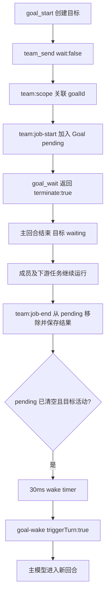

# Goal、监督器与持久定时任务的机制排查

本轮只读固定版本源码、现有测试源码及脱敏日志，没有编写业务实现、运行产品测试或调用真实模型。日期为 2026-10-17，Asia/Shanghai。日志时间在 JSON 证据中保留 UTC，本文例子同时给出北京时间。

## 范围与版本

| 参考 | 版本依据 | 本文检查范围 |
| --- | --- | --- |
| 本插件 | `c34e32fec02d43808c2e4d8b313017dba2347993` | Goal、监督器及事件耦合 |
| Pi 宿主 | 仓库 `vendor/pi-1.3.0/` | 生命周期事件及通知与回合关系；另由子审计覆盖具体运行链 |
| DSH | `1517a4dbca0a2789ff1d41ba439600f8547d23fa` | GoalService、goal-round-driver、tool-goal、schedule |
| Codex | `e16b631d08cdf82773831f9bbfb793da687d5299` | Goal 扩展、状态库、idle continuation |
| pi-goal-x | Git `64c5ace87f3400c0b55ef87f2d2912167f53dbaa`；包版本 0.32.3 | 调度意图、声明式等待、claim/generation、恢复 |

## G1：当前 Goal 通过生命周期事件维持继续执行

入口为 [goal_start](../../../extensions/goal/index.ts:335)，创建数据后写 `custom:goal-state`，默认预算为 20 次自动继续、60 分钟、100,000 个主模型输出 token（同文件 182–208）。它不是后台常驻调度器。

主要路径：



代码依据：

- [team:scope](../../../extensions/goal/index.ts:293) 在目标未 completed/stopped 时写 goalId；**paused/blocked 也可以给新任务关联同一个 Goal**。
- [team:job-start/end](../../../extensions/goal/index.ts:296) 更新 pending 与 results。只有匹配 goalId 且存在于 pending 的完成事件被接受。
- [goal_wait](../../../extensions/goal/index.ts:348) 要求目标 running/waiting 且 pending 非空，返回 `terminate:true`；它自己没有挂住一个长时间等待 Promise，也不启动定时轮询。
- [wake/scheduleWake](../../../extensions/goal/index.ts:136) 在 pending 清空、预算通过时整理 results，再用 `triggerTurn:true, deliverAs:followUp` 送达。
- [agent_before_settle](../../../extensions/goal/index.ts:256) 在正常结束且无 pending、无已有排队消息时追加 `goal-continue` 并 `continue:true`；有 pending 则保存 waiting，不发空继续。

因此至少有两种“继续”：同一宿主运行收束前的 `continue:true`，以及成员完成后发消息启动后续回合。它们不能与 UI 上同一个“运行中”状态混为一谈。

`goal_wait` 的空pending拒绝还可能是时序竞态：任务在dispatch返回和wait执行之间已经完成。不能只凭此报错认定主模型协调错误；必须对齐job身份、完成时点和此前工具返回。日志中的10次错误是统计值，并未逐一证明都属于同一根因。

### 暂停、恢复与预算

[restore](../../../extensions/goal/index.ts:159) 会在 reload/恢复/切分支时清空旧 pending，并把当时活动或有 pending 的未完成目标置 paused，要求重新派工。这和团队的成员身份可恢复不是同一承诺：**成员会话可恢复，不等于正在执行的任务可恢复**。

恢复入口只有 [/goal resume](../../../extensions/goal/index.ts:438)，它把 continuation/outputTokens 归零并重设 budgetStartedAt。模型工具表里没有 `goal_resume`；`goal_update` 只改目标定义、清证据，不把 paused 变 running（同文件 318–324）。所以“用户已让模型继续”与“目标控制已恢复”可以分离。

例外是 [before_agent_start 的 provider-error 恢复](../../../extensions/goal/index.ts:217)：当启动消息恰是 supervisor-check、目标 paused 且 pauseCause=provider-error 时，在原预算内恢复。用户暂停、blocked、预算耗尽不走该路径。

时间预算按 `Date.now()-budgetStartedAt`，包含等待和进程不活跃后的经过时间；输出预算只加主会话 assistant.usage.output（同文件 240–245），不等于所有成员的总体成本。`goal_finish` 的证据是每条验收条件对应一段非空模型提交文本，另可执行配置的 verificationCommands；这并不自动证明证据内容真实或全面。

## G2：监督器的间隔设置并不是最短检查间隔

这是本轮新增的已确认问题，应修正前轮“提前触发仍待核实”的过保守结论。

关键调用链：

1. [JobGraph.start](../../../extensions/team/job-graph.ts:16) 记录任务并调用 `h.start(job)`。
2. [team 构造 JobGraph 时的 start hook](../../../extensions/team/index.ts:322) 发 `team:job-start`，根任务和 peer 下游任务都走这条链。
3. [supervisor 监听器](../../../extensions/supervisor/index.ts:365) 每次收到 start 都调用 `schedule(0)`。
4. [schedule](../../../extensions/supervisor/index.ts:177) 先清掉旧 timer，然后按传入的 0 延迟设新 timer。
5. [tick](../../../extensions/supervisor/index.ts:191) 检查有工作、主会话 idle、无排队输入和无检查在途后调用 sendCheck。这里没有 `now-lastCheckAt >= intervalMs` 的判断。
6. [sendCheck](../../../extensions/supervisor/index.ts:212) 以 `triggerTurn:true` 发检查；即使是任务启动触发，原因仍标成 `interval`。

条件很关键：如果 0 延迟 tick 发生时主回合还在跑，它只会重排常规 interval；如果主会话已处 waiting/idle，而监督员给执行员派新的下游任务，则可以立即唤醒主会话。不是“每个 task-start 必定唤醒”。

### 日志交叉证据

[supervisor-timeline.json](../../../.reference/investigation/2026-10-17/supervisor-timeline.json)、[supervisor-correlation.json](../../../.reference/investigation/2026-10-17/supervisor-correlation.json) 与 [汇总](../../../.reference/investigation/2026-10-17/supervisor-summary.json) 由已脱敏 LF 派生数据生成。

- L3359：2026-10-17 08:15:12 北京时间，supervisor_control on，seconds=1800。
- L3381：08:16:14.029，GPU 执行员下游任务进入 running；L3382：08:16:14.039，supervisor-check #1，差 10 ms。
- L3694：08:41:15.749，检查 #14；L3705：08:41:34.578，CPU 下游任务 running；L3706：08:41:34.589，检查 #15。两次检查间隔 **18.840 秒**，后一次距任务状态记录 **11 ms**。
- 共 21 次检查，20 个相邻间隔中 19 个小于 1800 秒；19 次检查在 peer 下游任务 running 状态记录后 30 ms 内出现。

时间相关性本身不是因果证明，以上源码链提供了对应机制。既有 [监督器测试](../../../extensions/supervisor/tests/supervisor.test.mjs:66) 甚至明确期望 `on → job-start → 30ms内收到检查`，没有断言固定最短间隔。本轮只阅读了测试，没有执行测试。

**责任边界更新**：主 AI 的微任务管理和擅自关闭监督器仍有日志证据，但后期持续被 supervisor-check 拉起，不能全部归咎于主 AI 主动轮询。插件自身存在确定的事件触发路径。

### 进程存活与重启

监督器所有状态在扩展闭包中；[session_start](../../../extensions/supervisor/index.ts:316) 重新设置 enabled=false、interval=60秒并清空 pendingJobs。它不从 roster 恢复自己的完整 pending map；后续任务 start 才重新填充。

[workActive](../../../extensions/supervisor/index.ts:147) 会让非 provider-error 的 paused/blocked/stopped/completed Goal 对应任务保持安静；普通未归属该暂停目标的任务仍可算活动。其恢复重试默认最多 3 次，每次 3 秒，但 start/end 会重置 recoveryAttempts，因此这是活动过程中有限的局部恢复计数，不是持久化的全局重试预算。

`setTimeout(...).unref()` 不能让进程因定时器而常驻，更不能跨进程运行。关闭扩展/会话时 timer 被清除。这是会话内监督器，不是系统计划任务或独立守护进程。

## G3：DSH 把持久目标状态与本次进程的续跑资格分开

DSH 的 [Goal 类型](../../../.reference/sources/deepseek-harness/packages/goal/goal/src/types.ts:62) 将 durable phase 定义为 active/paused/blocked/complete，另有 process-local activation=armed/disarmed。两者不同：active 目标在重启后可以是 disarmed，不自动执行。

[GoalService](../../../.reference/sources/deepseek-harness/packages/goal/goal/src/index.ts:250) 在 agent/created 时 disarm。每个目标带 id+revision，修改通过 [expectCurrent](../../../.reference/sources/deepseek-harness/packages/goal/goal/src/index.ts:455) 比较当前 revision；实际 Agent 对象也必须是 registry 的当前实例。resume 可重新 armed 并增加 revision，但不会默默清掉历史 roundsStarted，预算耗尽要先明确增加 round cap（同文件 364–381）。

[goal-round-driver.drive](../../../.reference/sources/deepseek-harness/packages/goal/goal-round-driver/src/index.ts:145) 的链路为：

1. 确认精确 Agent 生命周期仍存在、idle 且没有竞争输入。
2. 对状态变更做持久 checkpoint；失败则 disarm。
3. `waitForChildren(agent)` 等待正在推进的子任务；但manager.ts:275–277对idle且已有nextTurn/nextStep inbox的child跳过该等待项。它不是“所有子成员收件箱都已处理完”的严格屏障，父目标轮次仍可能先继续；子成员activation由自然结算watcher另行保留。
4. 检查 round cap，创建带 goalId/revision/round/messageId 的 reservation。
5. followup 入 inbox；queued → claimed → admitted 随 inbox 和 user/message 持久事件推进。
6. [pre-step](../../../.reference/sources/deepseek-harness/packages/goal/goal-round-driver/src/index.ts:364) 在实际调用模型前重验 claimed/nonstale、revision、round、phase、activation及精确内容/source；失效则 reject 并保留其他已领取消息。取消由 inbox discarded、aborted turn/end 和 idle 收束处理，pre-step 的 validReservation 谓词本身不直接检查 attempt.cancelled；执行下游pre-step后还检查 signal。

因此“timer 没触发两次”不是唯一去重措施：即使迟到消息已经进 inbox，仍有 pre-step 的权限与代次检查。

工具和 UI 服务的权限不完全相同。[tool-goal](../../../.reference/sources/deepseek-harness/packages/goal/tool-goal/src/index.ts:270) 要求 edit/pause/resume 来自直接顶层用户回合，并且 model-facing resume 对当前 phase=paused 明确拒绝，需要用户从宿主恢复。不能把 DSH 的 service.resume 存在直接理解成“模型能解除用户暂停”。完成/blocked 可在精确当前目标自动轮次中调用；[authority](../../../.reference/sources/deepseek-harness/packages/goal/tool-goal/src/authority.ts:80) 根据消息 source 和当前回合边界判断，而不是信任模型说“用户授权了”。

## G4：DSH schedule 是 Host 级持久投递，不是模型执行保证

[ScheduleService](../../../.reference/sources/deepseek-harness/packages/schedule/schedule/src/index.ts:154) 在 Host 存储域就绪后加载全部任务并 requestDrive；任务保存原目标 sessionId、记录、active/inactive 状态、最近交付和历史。新任务 create 先写存储再发 changed/重排，所有管理与投递共用 [serialize FIFO](../../../.reference/sources/deepseek-harness/packages/schedule/schedule/src/index.ts:463)。读取/删除不用先启动模型会话。

[ScheduleRuntime](../../../.reference/sources/deepseek-harness/packages/schedule/schedule/src/runtime.ts:85) 的实际投递顺序：

```text
扫描到期 active 记录
  → sessionController.resolveAgent(原sessionId)
  → 按实际当前时间重算到期发生次
  → 组合同一session的到期循环提醒
  → agent.followup(source.kind=schedule)
  → sessions.flush(session)
  → schedule任务存储：记录messageId回执，停用一次性任务或推进下一次
  → 为最近未来时间设一个分段timer
```

`after/at/every/daily/weekly/cron` 的递推由 [domain.ts](../../../.reference/sources/deepseek-harness/packages/schedule/schedule/src/domain.ts:791) 负责；循环任务只补最近一次错过的 occurrence，不补一串旧提醒。daily/weekly/cron 保留时区含义，不把“一天”固定当 86400 秒。timer 超过 Node 上限会分段重设。

**已确认的非原子窗口**：inbox flush 成功与任务回执更新不在一个原子事务中。如果进程在两者之间崩溃，重启后同一提醒可能再次投递。源码的任务状态与注释、[schedule AGENTS](../../../.reference/sources/deepseek-harness/packages/schedule/AGENTS.md:8) 都明确这一点。因此不能称 exactly-once，也不能把 delivered 回执当成模型完成处理。

失败保持任务存储并记录警告，不加无限自动重试。本次 drive 将失败任务排除于下一 timer 选择，但它们可能在后续启动/存储变化等新的 requestDrive 时再次被考虑。关闭 Host 会 drain 已接受的运行并清 timer；Host 未运行时不会在后台执行模型请求。

## G5：Codex Goal 在 Host idle 入口决定是否开新回合

[GoalExtension.on_thread_idle](../../../.reference/sources/codex/codex-rs/ext/goal/src/extension.rs:180) 调用 [continue_if_idle](../../../.reference/sources/codex/codex-rs/ext/goal/src/runtime.rs:436)。这段执行持有 goal-state permit，检查工具可用、持久 deferral、ThreadManager/线程仍可用、持久 Goal status=Active，再通过 `start_turn_if_idle` 申请自动回合。自动输入带 `turn_trigger=goal`，成功后记录本次 continuation turnId；没有盲目不断排队同一个继续消息。

状态保存于 [state::ThreadGoal](../../../.reference/sources/codex/codex-rs/state/src/model/thread_goal.rs:14)，包括 active/paused/blocked/usage_limited/budget_limited/complete、goalId、预算、tokens_used 和 time_used。预算统计还提供 [descendant token accounting](../../../.reference/sources/codex/codex-rs/ext/goal/src/accounting.rs:19)，不是本插件的“仅主模型输出 token”。

这不表示 Codex 桌面的定时自动化实现已被本轮公开仓库完整覆盖。也不表示其完成通知会自动启动 idle 父回合；该问题由 delegation-lifecycle 报告单独追链，不能拿 Goal continuation 混作普通成员完成通知。

## G6：pi-goal-x 的事件等待有独立调度身份

0.32.3 的 [GoalScheduler](../../../.reference/sources/plugins/pi-goal-x/extensions/goal-scheduler.ts:9) 在持久 Goal 中保存 owner=sessionId、generation、phase、decision、dispatch、used、wait。timer 只是唤醒机会，**先 claim 调度身份与额度，再发送模型继续消息**。

- [declare wait](../../../.reference/sources/plugins/pi-goal-x/extensions/goal-scheduler.ts:150) 需要严格执行配置、明确 deadline；保存 waitId/token 后 `terminate:true`，返回 token 给生产者。可选轮询有次数与间隔限制。
- [signal](../../../.reference/sources/plugins/pi-goal-x/extensions/goal-scheduler.ts:262) 只有 goalId、owner、waiting phase 和 token 全匹配且未 signalled 才接受事件；不是拿任意 text 消息唤醒。
- [claim](../../../.reference/sources/plugins/pi-goal-x/extensions/goal-scheduler.ts:302) 校验 generation、额度、deadline；分 kickoff/ready/repair/recovery/wake/check，产生唯一 dispatchId 并改变 phase。
- [message 领取](../../../.reference/sources/plugins/pi-goal-x/extensions/goal-scheduler.ts:197) 校验 checkpoint v3、claimed、generation、dispatchId，拒绝陈旧请求并 abort。
- [restore](../../../.reference/sources/plugins/pi-goal-x/extensions/goal-scheduler.ts:98) 遇到上次 claimed/running/interrupted 会暂停等待用户 resume，不重放已领取执行。
- [GoalRuntime](../../../.reference/sources/plugins/pi-goal-x/extensions/goal-runtime.ts:151) 等 idle 且无排队输入后送小 checkpoint marker；完整 Goal 提示由后续 hook/context 路径提供。
- [agent_settled](../../../.reference/sources/plugins/pi-goal-x/extensions/goal-events.ts:548) 是正式继续或网络恢复的入口，避免在 agent_end、Pi 自己还要重试/压缩时抢开回合。

其 timer 仍为进程内 setTimeout；持久化调度意图并不意味着 Pi 进程关闭后会独立定时启动。外部生产者也必须在实际事件发生前保留并正确提交 wait token，否则会有“结果早到但尚未注册 token”的竞态；源码工具返回已明确要求适配器保存 early results。

## 本轮核对边界

已完成源码调用链及日志相关性核对；未运行任何产品测试、故障注入或真实模型调用。仍需未来实验确认：不同扩展同时触发时 Pi 实际调度顺序、强杀时各组件落盘窗口、网络重连后的完整行为、睡眠唤醒和跨时区场景。以上不是实施计划，只标明静态证据不能替代的运行事实。
